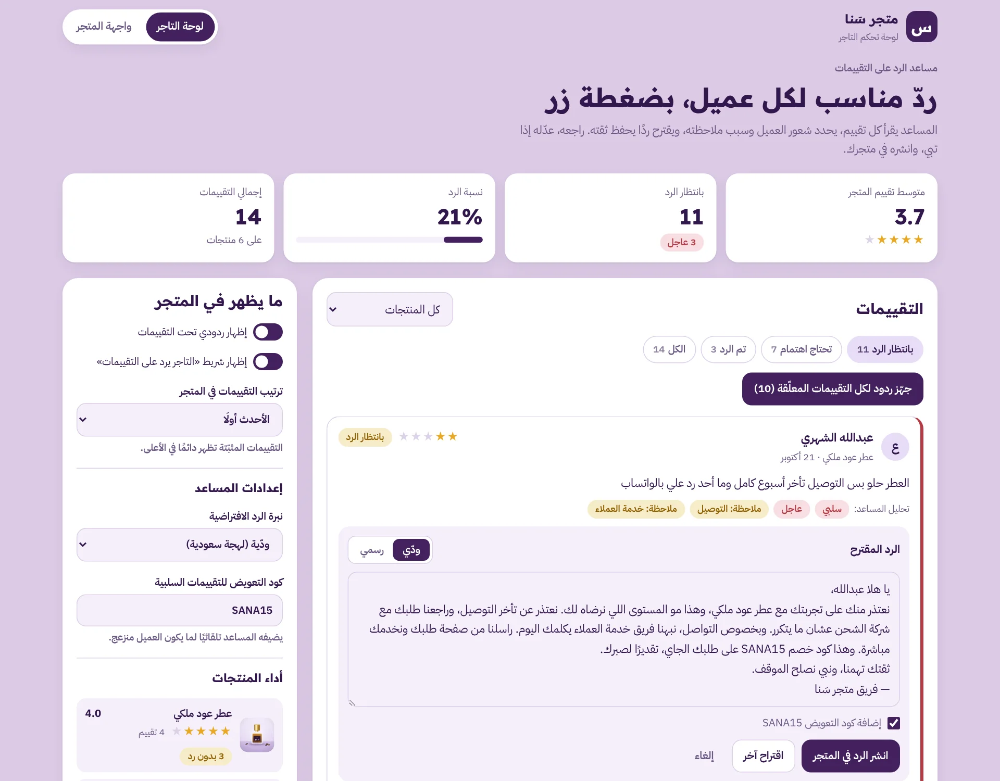
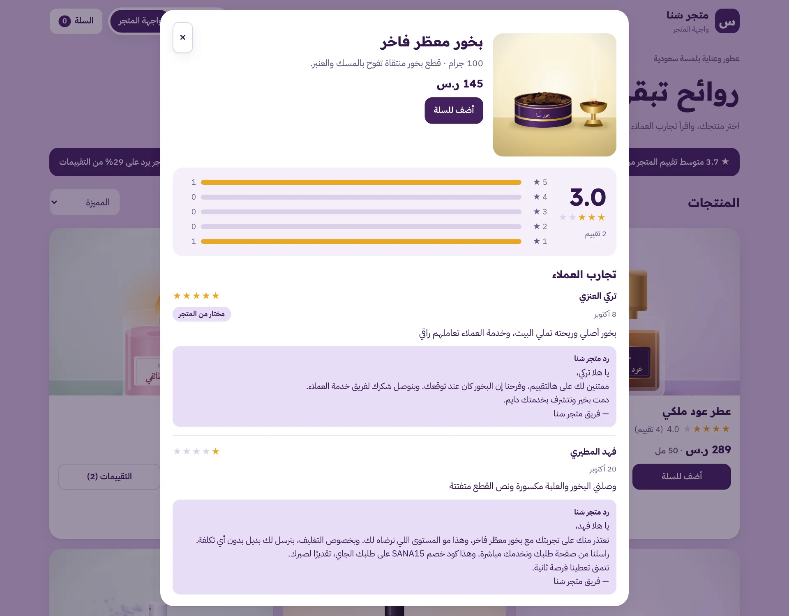
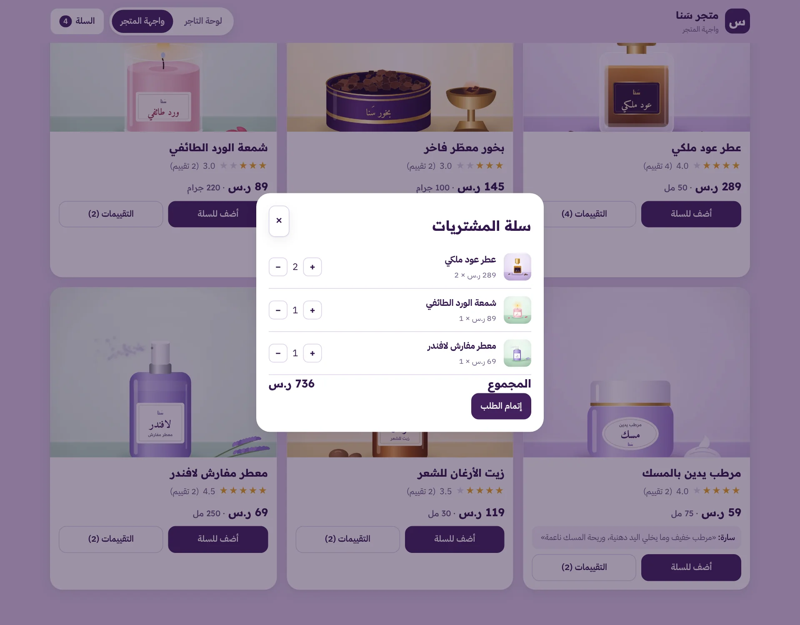

# متجر سَنا | مساعد الرد على التقييمات

لوحة تحكم للتاجر تقرأ تقييمات العملاء، تحدد شعور العميل وسبب ملاحظته، وتقترح ردًا مناسبًا يحفظ ثقته. التاجر يراجع الرد، يعدّله إذا احتاج، وينشره في المتجر بضغطة زر.

**جرّبه مباشرة:**
- لوحة التاجر: https://zid-new.rahommy11.workers.dev/
- واجهة المتجر: https://zid-new.rahommy11.workers.dev/store

## لقطات من الموقع

الموقع يتبع وضع جهازك (فاتح أو داكن)، واللقطات هنا تظهر بنفس وضع GitHub عندك.

### لوحة التاجر
المساعد حلّل تقييم عبدالله (تأخر التوصيل وما أحد رد عليه)، وجهّز له ردًا يعتذر ويضيف كود تعويض.

<picture>
  <source media="(prefers-color-scheme: dark)" srcset="docs/screenshots/dashboard-dark.webp">
  
</picture>

### واجهة المتجر
المنتجات بصورها وأسعارها وتقييماتها، مع شريط يوضح إن التاجر يرد على التقييمات.

<picture>
  <source media="(prefers-color-scheme: dark)" srcset="docs/screenshots/store-dark.webp">
  
</picture>

### صفحة المنتج والتقييمات
توزيع النجوم وتجارب العملاء، ورد المتجر ظاهر تحت كل تقييم، حتى التقييم السلبي.

<picture>
  <source media="(prefers-color-scheme: dark)" srcset="docs/screenshots/reviews-dark.webp">
  
</picture>

### السلة

<picture>
  <source media="(prefers-color-scheme: dark)" srcset="docs/screenshots/cart-dark.webp">
  
</picture>

## لوحة التاجر

- **ملخص سريع:** متوسط تقييم المتجر، عدد التقييمات اللي تنتظر رد، ونسبة الرد.
- **تحليل كل تقييم:** إيجابي أو محايد أو سلبي، والموضوع اللي يتكلم عنه العميل (التوصيل، التغليف، السعر، الحجم، الجودة، خدمة العملاء، مطابقة الصورة).
- **ترتيب حسب الأهمية:** التقييمات السلبية تطلع أول وعليها علامة «عاجل».
- **رد مقترح جاهز:** بنبرة ودّية باللهجة السعودية أو رسمية بالفصحى، مع «اقتراح آخر» لو تبي صياغة ثانية.
- **كود تعويض:** يُضاف تلقائيًا للعميل المنزعج، وتقدر تغيّره من الإعدادات.
- **ردود جماعية:** جهّز ردود لكل التقييمات المعلّقة وانشرها مرة وحدة.
- **التحكم بالعرض:** إخفاء تقييم، تثبيته أعلى صفحة المنتج، وترتيب التقييمات في المتجر.
- **أداء المنتجات:** متوسط تقييم كل منتج وعدد التقييمات اللي بدون رد.

## واجهة المتجر

- المنتجات بصورها وأسعارها وتقييماتها.
- صفحة لكل منتج فيها توزيع النجوم، تجارب العملاء، وردود المتجر تحتها.
- العميل يقدر يكتب تقييم جديد، ويوصل مباشرة للوحة التاجر.
- سلة مشتريات تجريبية.

## جرّب الفكرة كاملة في دقيقة

1. افتح **واجهة المتجر** واكتب تقييمًا على أي منتج.
2. افتح **لوحة التاجر**، تلقى تقييمك فوق مع تحليل المساعد.
3. اضغط «اقترح ردًا»، عدّله إذا تبي، ثم «انشر الرد في المتجر».
4. ارجع للمتجر وشوف ردك ظاهر تحت التقييم.

البيانات تجريبية ومحفوظة في متصفحك فقط. زر «إرجاع البيانات التجريبية» في اللوحة يرجّعها لوضعها الأول.

## الملفات

| الملف | وش فيه |
| --- | --- |
| `public/index.html` | لوحة التاجر |
| `public/store.html` | واجهة المتجر |
| `public/assistant.js` | تحليل التقييمات وكتابة الردود |
| `public/dashboard.js` | منطق لوحة التاجر |
| `public/store.js` | منطق واجهة المتجر |
| `public/app.js` | البيانات التجريبية والدوال المشتركة |
| `public/style.css` | التصميم (فاتح وداكن، ويدعم الجوال) |
| `public/img/` | صور المنتجات |
| `wrangler.jsonc` | إعدادات النشر على Cloudflare |

## النشر

الموقع منشور على **Cloudflare Workers** كملفات ثابتة من مجلد `public/`. أي تعديل ينرفع على فرع `main` ينشر تلقائيًا خلال دقيقة تقريبًا.

للتشغيل على جهازك:

```bash
npx wrangler dev
```
